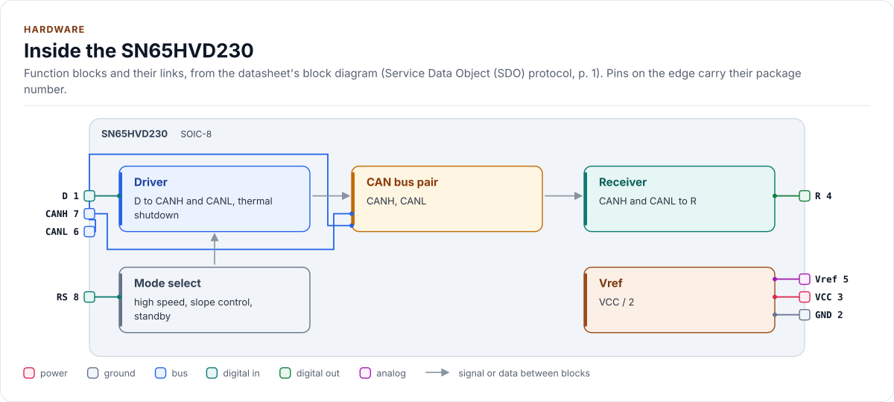
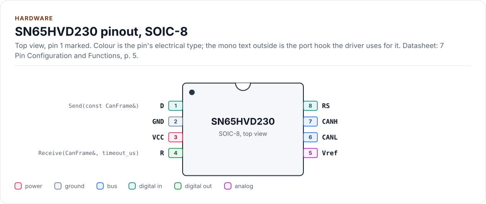
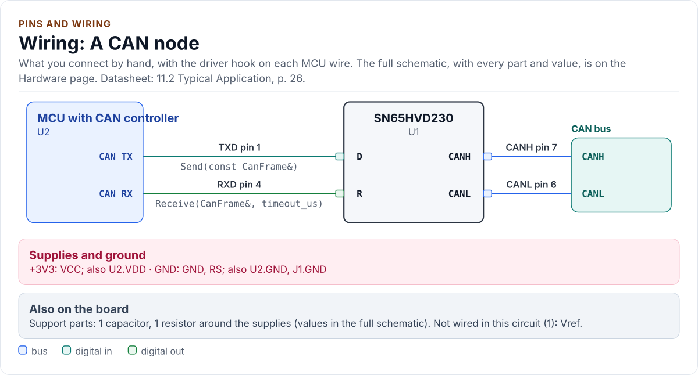

# CANOPEN_CLIENT Driver

<!-- generated: chip-summary -->
The **SN65HVD230** is a 3.3 V CAN transceiver, the reference physical layer of a CANopen node: it turns a CAN
controller's TXD and RXD into the differential CANH and CANL signals of an ISO 11898-2 bus, and this driver speaks
CANopen to the nodes on that bus (1 Features, 2 Applications, 3 Description, [p.
1](https://www.ti.com/lit/ds/symlink/sn65hvd230.pdf#page=1)).
<!-- /generated -->

[](https://github.com/kokeb-labs-drivers/driver-canopen-client/actions/workflows/ci.yml)
[](LICENSE)
[](docs/installation.md#requirements)

**Documentation: [`docs/`](docs/index.md)**, with the API reference built by Doxygen ([how](docs/api-reference.md)).
The site at <https://kokeb-labs-drivers.github.io/driver-canopen-client/> opens when the repository is public.

<!-- figure: chip-hero -->
<picture>
  <source media="(prefers-color-scheme: dark)" srcset="docs/diagrams/chip-hero.dark.svg">
  
</picture>
<!-- /figure -->

## What it does

<!-- figure: chip-capabilities -->
<picture>
  <source media="(prefers-color-scheme: dark)" srcset="docs/diagrams/chip-capabilities.dark.svg">
  
</picture>
<!-- /figure -->

## Where it is used

<!-- generated: chip-uses -->
- Industrial automation, control, sensors and drive systems
- Motor and robotic control
- Building and climate control (HVAC)
- Telecom and basestation control and status
- CAN bus standards such as CANopen, DeviceNet and CAN Kingdom

Uses named by the datasheet (1 Features, 2 Applications, 3 Description, [p.
1](https://www.ti.com/lit/ds/symlink/sn65hvd230.pdf#page=1)).
<!-- /generated -->

## Inside the device

<!-- figure: chip-blocks -->
<picture>
  <source media="(prefers-color-scheme: dark)" srcset="docs/diagrams/chip-blocks.dark.svg">
  
</picture>
<!-- /figure -->

## Pins and wiring

<!-- figure: chip-pinout -->
<picture>
  <source media="(prefers-color-scheme: dark)" srcset="docs/diagrams/chip-pinout.dark.svg">
  
</picture>
<!-- /figure -->

<!-- figure: chip-wiring-typical -->
<picture>
  <source media="(prefers-color-scheme: dark)" srcset="docs/diagrams/chip-wiring-typical.dark.svg">
  
</picture>
<!-- /figure -->

| MCU | Transceiver | Notes |
| --- | --- | --- |
| CAN TX | D (TXD) | |
| CAN RX | R (RXD) | |
| 3.3 V | VCC | 100 nF to GND close to the pin |
| GND | GND, RS | RS to GND is high speed on the SN65HVD230; 120 Ω at each end of the bus |

## Quick start

**1. Wire it** as in [Pins and wiring](#pins-and-wiring).

**2. Write the port**: a class with `EnsureInitialized()` (start the controller), `Send()`, `Receive()` and `NowUs()`,
about 30 lines on most SDKs. [Porting](docs/porting.md) has the contract and a complete example.

**3. Talk to a node:**

<!-- generated: quickstart-code -->
```cpp
#include "canopen_client.hpp"

int read_node_and_start_it(MyPort& port, uint32_t& device_type) {
  canopen_client::Client<MyPort> client(port); // no I/O yet

  if (auto r = client.EnsureInitialized(); !r) { // 1. CAN controller up
    return static_cast<int>(r.error);            //    Bus: the port could not start it
  }
  const auto type = client.ReadDeviceType(5); //    2. SDO read of object 0x1000 from node 5
  if (!type) {
    return static_cast<int>(type.error); //    Timeout: nobody answered; SdoAbort: the node refused
  }
  device_type = type.value;
  if (auto r = client.SendNmt(canopen_client::NmtCommand::Start, 5);
      !r) { // 3. node 5 to Operational
    return static_cast<int>(r.error);
  }
  return 0;
}
```
<!-- /generated -->

`EnsureInitialized()` is the only call that starts the port. Every other call returns `Error::NotInitialized`
until it has succeeded, and no call starts the port on its own.

## Driver coverage

<!-- generated: chip-coverage -->
| Capability | What the protocol does | Driver API | Objects | Status | Host test | Datasheet |
| --- | --- | --- | --- | --- | --- | --- |
| [Start and stop nodes](docs/api-guide.md) | Sends the NMT commands that start, stop, pre-operate and reset one node or all of them | `SendNmt` | `PreOperational`, `ResetNode`, `ResetCommunication` | Supported | [`test_lifecycle.cpp`](tests/test_lifecycle.cpp) | Network management (NMT), p. 1 |
| [Read and write objects](docs/api-guide.md) | Reads and writes object dictionary entries, in one frame or in segments, with the node's abort code | `SdoUpload`, `SdoDownload`, `SdoReadU8`, `SdoReadU16`, `SdoReadU32`, `SdoWriteU8`, `SdoWriteU16`, `SdoWriteU32`, `SdoDownloadUnconfirmed` | - | Supported | [`test_sdo.cpp`](tests/test_sdo.cpp) | SdoClient: initiate, upload, download, segments, p. 1 |
| [Heartbeat, guarding and emergencies](docs/api-guide.md) | Watches node heartbeats and guarding replies, and queues the emergency messages nodes send | `MonitorNode`, `UnmonitorNode`, `GetNodeStatus`, `ClearBootUp`, `GuardNode`, `Poll`, `PopEmcy` | - | Supported | [`test_rx.cpp`](tests/test_rx.cpp), [`test_faults.cpp`](tests/test_faults.cpp) | CO_HBconsumer.c, p. 1 |
| [SYNC producer](docs/api-guide.md) | Sends the SYNC frame, once or on a period with the optional counter byte | `SendSync`, `ConfigureSync`, `ServiceSync` | - | Supported | [`test_rx.cpp`](tests/test_rx.cpp) | CO_SYNC.h: SYNC frame and counter, p. 1 |
| [Process data](docs/api-guide.md) | Maps and enables a node's PDOs in the order the profile asks, reads TPDO samples and sends RPDOs | `ConfigurePdo`, `DisablePdo`, `ReadPdoConfig`, `SubscribeTpdo`, `UnsubscribeTpdo`, `ReadTpdo`, `SendRpdo` | - | Supported | [`test_pdo.cpp`](tests/test_pdo.cpp) | PDO map and communication records, p. 1 |
| [CiA 402 drive control](docs/api-guide.md) | Reads the drive state and walks it to enabled, disabled, quick stop or fault reset, and sets the mode (disable and quick stop are never refused for the drive state) | `ReadDriveState`, `ReadStatusword`, `DriveEnable`, `DriveDisable`, `DriveQuickStop`, `DriveResetFault`, `SetDriveMode`, `ReadDriveMode` | `ProfilePosition`, `Velocity`, `ProfileVelocity`, `CyclicSynchronousPosition` | Supported | [`test_drive.cpp`](tests/test_drive.cpp) | BaseNode402: states, masks, transitions, p. 1 |
| [Node identity and settings](docs/api-guide.md) | Reads a node's device type and error register, sets its heartbeat time, stores or restores its parameters | `ReadDeviceType`, `ReadErrorRegister`, `WriteHeartbeatProducerTime`, `StoreParameters`, `RestoreDefaults` | - | Supported | [`test_sdo.cpp`](tests/test_sdo.cpp) | CO_storage.c: signatures and sub-indices, p. 1 |
| [Raw frames](docs/api-guide.md) | Sends and reads any classic CAN frame and returns the raw reply of an SDO request | `SendRawFrame`, `ReadRawFrame`, `ReadRawSdo`, `WriteRawSdo` | - | Supported | [`test_hardening.cpp`](tests/test_hardening.cpp) | Pre-defined connection set (COB-IDs), p. 1 |
| [Block transfer, FD and LSS](docs/contract.md) | Block transfer, CAN FD, 29-bit identifiers, LSS, an NMT slave and an SDO server are not implemented | - | - | Not covered | - | Service Data Object (SDO) protocol, p. 1 |

**Supported**: the driver implements it and the named host test checks it; **Not covered**: the protocol defines it and
the driver leaves it out.

From [`docs/hardware.yml`](docs/hardware.yml); `kokeb-docs hardware --check` confirms that every API name is in
`inc/canopen_client.hpp`, `inc/canopen_client_types.hpp` and every object in `inc/canopen_client_types.hpp`,
`inc/canopen_client_protocol.hpp` and every named test exists.
<!-- /generated -->

A generic, product-agnostic CANopen client: NMT master, SDO client, heartbeat, EMCY, SYNC, PDO helpers and a CiA 402
drive state machine over a classic CAN frame port.

It speaks CANopen to the nodes on a CAN bus: it commands them (NMT), reads and writes their objects (SDO), watches their
heartbeats and emergency messages, produces SYNC, configures and reads process data (PDO), and runs a CiA 402 drive
through its state machine. It is not tied to a product: you give it a small class that sends one frame, waits for one
and reads a microsecond clock, and it does the rest on any MCU.

| | |
| --- | --- |
| **Does** | NMT master, SDO client (expedited and segmented), heartbeat and node guarding consumer, EMCY queue, SYNC producer, TPDO and RPDO, CiA 402 drive helpers |
| **Bus** | Classic CAN, 11-bit identifiers, through a port you write (`Send`, `Receive`, `NowUs`) |
| **Reference transceiver** | TI SN65HVD230, 3.3 V ([Hardware](docs/hardware.md)) |
| **Driver** | Header-only C++20; no heap, exceptions, RTTI or virtual calls; every call returns `Result<T>` |
| **Runs on** | Any MCU with a CAN controller and a C++20 compiler; the host example runs on any PC ([Platforms](docs/platforms.md)) |
| **Status** | 0.1.0, not yet verified on hardware: host-tested against a model of the bus and its nodes. The CANopen specifications were not obtained ([Contract](docs/contract.md#what-is-not-verified)) |

- Reads and writes any object of a node with SDO, expedited or segmented, and returns the node's own abort code.
- Consumes heartbeats and node guarding, queues emergency messages, stores TPDOs and produces SYNC.
- Configures a PDO in the order the profile prescribes, so a failure never leaves it half configured and valid.
- Walks a CiA 402 drive through its states, and always puts a stop or disable on the wire, up to `safety_attempts`
  times and even when the port's receive side fails.
- Treats a lying or flooding node as untrusted: bounded buffers, bounded waits, checked toggle bits and sizes.
- Returns `Result<T>` with an `Error` from every call: no exceptions, no heap, no RTTI, no virtual calls.

## Documentation

| Page | Read it when you want to |
| --- | --- |
| [Quickstart](docs/quickstart.md) | Go from a bare transceiver to a node's device type on your MCU |
| [Hardware](docs/hardware.md) | Wire a transceiver and terminate the bus |
| [Porting](docs/porting.md) | Write the port class for your MCU's SDK |
| [API guide](docs/api-guide.md) | Use each call: objects, heartbeats, PDOs, the drive, errors |
| [Configuration](docs/configuration.md) | Set the timeouts, or start from a preset |
| [Troubleshooting](docs/troubleshooting.md) | Find the cause of an error or a silent node |
| [Contract](docs/contract.md) | Know exactly what the driver promises, needs and returns |
| [Datasheet map](docs/datasheet.md) | Find the source document behind each part of the driver |
| [Ambiguities](docs/ambiguities.md) | See what the secondary sources cannot settle until CiA 301 and CiA 402 are obtained |
| [API reference](docs/api-reference.md) | Look up a class or member (Doxygen; built by CI and locally) |

## Datasheet

<!-- generated: datasheet-card -->
| Document | Revision | Get it |
| --- | --- | --- |
| Datasheet: SN65HVD23x 3.3-V CAN Bus Transceivers (Texas Instruments SN65HVD230, SN65HVD231, SN65HVD232 (SLOS346)) | O, 2018-04 | [PDF](https://www.ti.com/lit/ds/symlink/sn65hvd230.pdf) · [vendor page](https://www.ti.com/product/SN65HVD230) |
| Reference: CANopen (Wikipedia contributors Wikipedia article (oldid 1373604442)) | last edited September 2026, 2026-09 | [vendor page](https://en.wikipedia.org/wiki/CANopen) |
| Reference: CANopen Explained - A Simple Intro (CSS Electronics canopen-tutorial-simple-intro) | 2026 edition, 2026 | [vendor page](https://www.csselectronics.com/pages/canopen-tutorial-simple-intro) |
| Source: CANopenNode 301/CO_SDOserver.h (CANopenNode project CO_SDOserver.h) | master as downloaded, 2026-11 | [vendor page](https://github.com/CANopenNode/CANopenNode/blob/master/301/CO_SDOserver.h) |
| Source: CANopenNode 301/CO_Emergency.h (CANopenNode project CO_Emergency.h) | master as downloaded, 2026-11 | [vendor page](https://github.com/CANopenNode/CANopenNode/blob/master/301/CO_Emergency.h) |
| Source: CANopenNode 301/CO_HBconsumer.c (CANopenNode project CO_HBconsumer.c) | master as downloaded, 2026-11 | [vendor page](https://github.com/CANopenNode/CANopenNode/blob/master/301/CO_HBconsumer.c) |
| Source: CANopenNode 301/CO_SYNC.h (CANopenNode project CO_SYNC.h) | master as downloaded, 2026-11 | [vendor page](https://github.com/CANopenNode/CANopenNode/blob/master/301/CO_SYNC.h) |
| Source: CANopenNode storage/CO_storage.c (CANopenNode project CO_storage.c) | master as downloaded, 2026-11 | [vendor page](https://github.com/CANopenNode/CANopenNode/blob/master/storage/CO_storage.c) |
| Source: canopen/sdo/client.py (christiansandberg python-canopen sdo/client.py) | master as downloaded, 2026-11 | [vendor page](https://github.com/christiansandberg/canopen/blob/master/canopen/sdo/client.py) |
| Source: canopen/sdo/constants.py (christiansandberg python-canopen sdo/constants.py) | master as downloaded, 2026-11 | [vendor page](https://github.com/christiansandberg/canopen/blob/master/canopen/sdo/constants.py) |
| Source: canopen/sdo/base.py (christiansandberg python-canopen sdo/base.py) | master as downloaded, 2026-11 | [vendor page](https://github.com/christiansandberg/canopen/blob/master/canopen/sdo/base.py) |
| Source: canopen/nmt.py (christiansandberg python-canopen nmt.py) | master as downloaded, 2026-11 | [vendor page](https://github.com/christiansandberg/canopen/blob/master/canopen/nmt.py) |
| Source: canopen/emcy.py (christiansandberg python-canopen emcy.py) | master as downloaded, 2026-11 | [vendor page](https://github.com/christiansandberg/canopen/blob/master/canopen/emcy.py) |
| Source: canopen/network.py (christiansandberg python-canopen network.py) | master as downloaded, 2026-11 | [vendor page](https://github.com/christiansandberg/canopen/blob/master/canopen/network.py) |
| Source: canopen/pdo/base.py (christiansandberg python-canopen pdo/base.py) | master as downloaded, 2026-11 | [vendor page](https://github.com/christiansandberg/canopen/blob/master/canopen/pdo/base.py) |
| Source: canopen/profiles/p402.py (christiansandberg python-canopen profiles/p402.py) | master as downloaded, 2026-11 | [vendor page](https://github.com/christiansandberg/canopen/blob/master/canopen/profiles/p402.py) |

Written against these revisions; the SHA-256 of each file is in [`docs/datasheets.yml`](docs/datasheets.yml). Where each
part of the driver is in the datasheet: [Datasheet map](docs/datasheet.md).
<!-- /generated -->

Every docs page lists the datasheet sections it relies on.

## Try it on your PC

No hardware needed: [`examples/host`](examples/host/README.md) runs the driver against a simulated bus and drive node.
You need git, CMake 3.16+ and a C++20 compiler (GCC 10+, Clang 13+ or MSVC 2022).

1. Get the source:

   ```bash
   git clone https://github.com/kokeb-labs-drivers/driver-canopen-client.git && cd driver-canopen-client
   ```

2. Build and run the example:

   ```bash
   cmake -S examples/host -B build-example
   cmake --build build-example
   ./build-example/canopen_client_host_example
   ```

3. You should see the driver read a node, configure a PDO, enable a drive and receive an emergency message:

   ```text
   canopen_client driver 0.1.0 on the host
   node 5: device type 0x00020192
   TPDO 0x185: CD AB 5A
   drive: OperationEnabled
   EMCY from node 5: code 0x2310
   ```

To run the whole test suite instead: `cmake -S . -B build -DCANOPEN_CLIENT_BUILD_TESTS=ON && cmake --build build &&
ctest --test-dir build`.

## Add it to your project

Pick the row that matches your build; each is a few steps, and [Installation](docs/installation.md) has the
details.

| Your build | Steps below |
| --- | --- |
| Plain CMake: STM32 (CubeMX), RP2040 (Pico SDK), nRF Connect, a host app | [A](#a-cmake-any-mcu) |
| ESP-IDF | [B](#b-esp-idf) |
| An SDK or OS image that installs libraries | [C](#c-installed-package) |

### A. CMake, any MCU

1. Add the driver as a submodule, pinned to the version you chose:

   ```bash
   git submodule add https://github.com/kokeb-labs-drivers/driver-canopen-client.git external/driver-canopen-client
   ```

2. In your `CMakeLists.txt`, after `project()`:

   ```cmake
   add_subdirectory(external/driver-canopen-client)
   target_link_libraries(my_app PRIVATE canopen_client::canopen_client)   # brings the headers and C++20
   ```

3. In your code, `#include "canopen_client.hpp"`, write the port ([Porting](docs/porting.md)) and build. A first build
   that compiles the quickstart above is the check that the driver is wired in.

### B. ESP-IDF

1. Add the driver under your project's `components/`; ESP-IDF finds it there and names it after the folder:

   ```bash
   git submodule add https://github.com/kokeb-labs-drivers/driver-canopen-client.git components/canopen_client
   ```

2. In `main/CMakeLists.txt`, list it: `idf_component_register(SRCS "main.cpp" REQUIRES canopen_client)`.
3. `idf.py menuconfig` now has a **CANopen client** menu (the timeouts and options of `Config`),
   and `idf.py build` builds the driver with your app. [`examples/esp32`](examples/esp32) is a complete
   project with a port for the board.

### C. Installed package

1. Install it once into a prefix:

   ```bash
   cmake -S external/driver-canopen-client -B build-canopen_client && cmake --install build-canopen_client --prefix /opt/sdk
   ```

2. In your project, with `CMAKE_PREFIX_PATH=/opt/sdk`:

   ```cmake
   find_package(canopen_client 0.1 REQUIRED)
   target_link_libraries(my_app PRIVATE canopen_client::canopen_client)
   ```

The target is `canopen_client::canopen_client` every way, so switching later changes nothing else.

## Tests and quality

```bash
cmake -S . -B build -DCANOPEN_CLIENT_BUILD_TESTS=ON && cmake --build build && ctest --test-dir build
```

The host tests run the driver against a model of the bus and its nodes and produce each error the driver can
return. A fuzzer fails sends and receives, injects frames and checks the driver's promises after every call. CI also
builds for Cortex-M and gates coverage, complexity, sanitizers, fuzzing, clang-tidy, cppcheck and the handbook rules
(`.kokeb/handbook.yml`). See [Testing and CI](docs/testing.md), which lists every gate and its limit.

## License

MIT. See [LICENSE](LICENSE).
