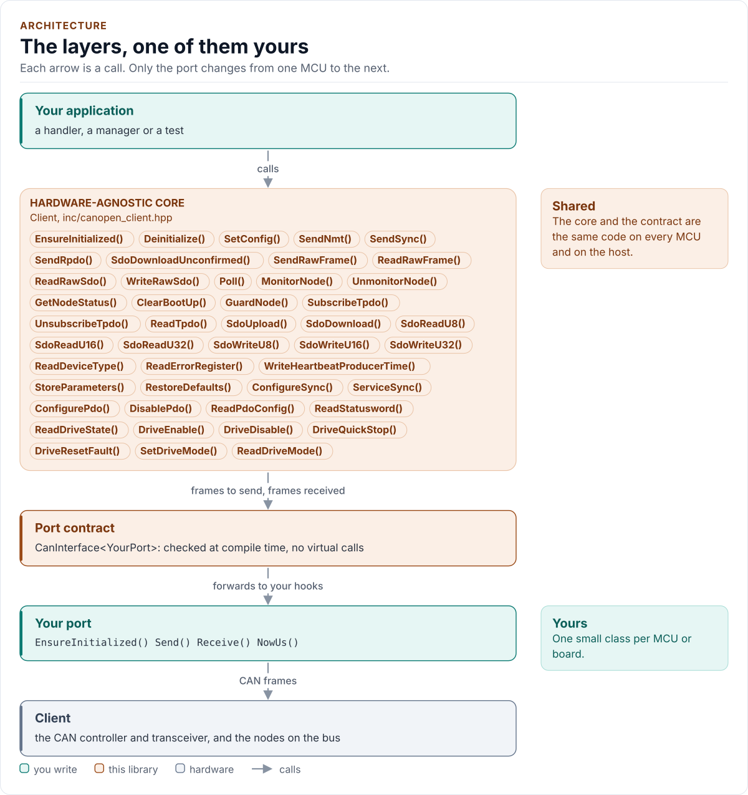

# CANOPEN_CLIENT Driver

A generic, product-agnostic CANopen client: NMT master, SDO client, heartbeat, EMCY, SYNC, PDO helpers and a CiA 402
drive state machine over a classic CAN frame port.

[](https://github.com/kokeb-labs-drivers/driver-canopen-client/actions/workflows/ci.yml)
[](LICENSE)
[](docs/installation.md#requirements)

**Documentation: [`docs/`](docs/index.md)**, with the API reference built by Doxygen ([how](docs/api-reference.md)).
The site at <https://kokeb-labs-drivers.github.io/driver-canopen-client/> opens when the repository is public.

It speaks CANopen to the nodes on a CAN bus: it commands them (NMT), reads and writes their objects (SDO),
watches their heartbeats and emergency messages, produces SYNC, configures and reads process data (PDO), and runs a
CiA 402 drive through its state machine. It is not tied to a product: you give it a small class that sends one frame,
waits for one and reads a microsecond clock, and it does the rest on any MCU.

<!-- figure: driver-layers -->
<picture>
  <source media="(prefers-color-scheme: dark)" srcset="docs/diagrams/driver-layers.dark.svg">
  
</picture>
<!-- /figure -->

## At a glance

| | |
| --- | --- |
| **Does** | NMT master, SDO client (expedited and segmented), heartbeat and node guarding consumer, EMCY queue, SYNC producer, TPDO and RPDO, CiA 402 drive helpers |
| **Bus** | Classic CAN, 11-bit identifiers, through a port you write (`Send`, `Receive`, `NowUs`) |
| **Reference transceiver** | TI SN65HVD230, 3.3 V ([Hardware](docs/hardware.md)) |
| **Driver** | Header-only C++20; no heap, exceptions, RTTI or virtual calls; every call returns `Result<T>` |
| **Runs on** | Any MCU with a CAN controller and a C++20 compiler; the host example runs on any PC ([Platforms](docs/platforms.md)) |
| **Status** | 0.1.0, not yet verified on hardware: host-tested against a model of the bus and its nodes. The CANopen specifications were not obtained ([Contract](docs/contract.md#what-is-not-verified)) |

## Datasheet

<!-- generated: datasheet-card -->
| Document | Revision | Get it |
| --- | --- | --- |
| Datasheet: SN65HVD23x 3.3-V CAN Bus Transceivers (Texas Instruments SN65HVD230, SN65HVD231, SN65HVD232 (SLOS346)) | O, 2018-04 | [PDF](https://www.ti.com/lit/ds/symlink/sn65hvd230.pdf) · [vendor page](https://www.ti.com/product/SN65HVD230) |
| Reference: CANopen (Wikipedia contributors Wikipedia article (oldid 1373604442)) | last edited September 2026, 2026-09 | [vendor page](https://en.wikipedia.org/wiki/CANopen) |
| Reference: CANopen Explained - A Simple Intro (CSS Electronics canopen-tutorial-simple-intro) | 2026 edition, 2026 | [vendor page](https://www.csselectronics.com/pages/canopen-tutorial-simple-intro) |
| Source: CANopenNode 301/CO_SDOserver.h (CANopenNode project CO_SDOserver.h) | master as downloaded, 2026-11 | [vendor page](https://github.com/CANopenNode/CANopenNode/blob/master/301/CO_SDOserver.h) |
| Source: CANopenNode 301/CO_Emergency.h (CANopenNode project CO_Emergency.h) | master as downloaded, 2026-11 | [vendor page](https://github.com/CANopenNode/CANopenNode/blob/master/301/CO_Emergency.h) |
| Source: CANopenNode 301/CO_HBconsumer.c (CANopenNode project CO_HBconsumer.c) | master as downloaded, 2026-11 | [vendor page](https://github.com/CANopenNode/CANopenNode/blob/master/301/CO_HBconsumer.c) |
| Source: CANopenNode 301/CO_SYNC.h (CANopenNode project CO_SYNC.h) | master as downloaded, 2026-11 | [vendor page](https://github.com/CANopenNode/CANopenNode/blob/master/301/CO_SYNC.h) |
| Source: CANopenNode storage/CO_storage.c (CANopenNode project CO_storage.c) | master as downloaded, 2026-11 | [vendor page](https://github.com/CANopenNode/CANopenNode/blob/master/storage/CO_storage.c) |
| Source: canopen/sdo/client.py (christiansandberg python-canopen sdo/client.py) | master as downloaded, 2026-11 | [vendor page](https://github.com/christiansandberg/canopen/blob/master/canopen/sdo/client.py) |
| Source: canopen/sdo/constants.py (christiansandberg python-canopen sdo/constants.py) | master as downloaded, 2026-11 | [vendor page](https://github.com/christiansandberg/canopen/blob/master/canopen/sdo/constants.py) |
| Source: canopen/sdo/base.py (christiansandberg python-canopen sdo/base.py) | master as downloaded, 2026-11 | [vendor page](https://github.com/christiansandberg/canopen/blob/master/canopen/sdo/base.py) |
| Source: canopen/nmt.py (christiansandberg python-canopen nmt.py) | master as downloaded, 2026-11 | [vendor page](https://github.com/christiansandberg/canopen/blob/master/canopen/nmt.py) |
| Source: canopen/emcy.py (christiansandberg python-canopen emcy.py) | master as downloaded, 2026-11 | [vendor page](https://github.com/christiansandberg/canopen/blob/master/canopen/emcy.py) |
| Source: canopen/network.py (christiansandberg python-canopen network.py) | master as downloaded, 2026-11 | [vendor page](https://github.com/christiansandberg/canopen/blob/master/canopen/network.py) |
| Source: canopen/pdo/base.py (christiansandberg python-canopen pdo/base.py) | master as downloaded, 2026-11 | [vendor page](https://github.com/christiansandberg/canopen/blob/master/canopen/pdo/base.py) |
| Source: canopen/profiles/p402.py (christiansandberg python-canopen profiles/p402.py) | master as downloaded, 2026-11 | [vendor page](https://github.com/christiansandberg/canopen/blob/master/canopen/profiles/p402.py) |

Written against these revisions; the SHA-256 of each file is in [`docs/datasheets.yml`](docs/datasheets.yml). Where each
part of the driver is in the datasheet: [Datasheet map](docs/datasheet.md).
<!-- /generated -->

Every docs page lists the datasheet sections it relies on.

## Try it on your PC

No hardware needed: [`examples/host`](examples/host/README.md) runs the driver against a simulated bus and drive node.
You need git, CMake 3.16+ and a C++20 compiler (GCC 10+, Clang 13+ or MSVC 2022).

1. Get the source:

   ```bash
   git clone https://github.com/kokeb-labs-drivers/driver-canopen-client.git && cd driver-canopen-client
   ```

2. Build and run the example:

   ```bash
   cmake -S examples/host -B build-example
   cmake --build build-example
   ./build-example/canopen_client_host_example
   ```

3. You should see the driver read a node, configure a PDO, enable a drive and receive an emergency message:

   ```text
   canopen_client driver 0.1.0 on the host
   node 5: device type 0x00020192
   TPDO 0x185: CD AB 5A
   drive: OperationEnabled
   EMCY from node 5: code 0x2310
   ```

To run the whole test suite instead: `cmake -S . -B build -DCANOPEN_CLIENT_BUILD_TESTS=ON && cmake --build build &&
ctest --test-dir build`.

## Use it on your MCU

**1. Wire it** ([Hardware](docs/hardware.md) has the reference circuit):

| MCU | Transceiver | Notes |
| --- | --- | --- |
| CAN TX | D (TXD) | |
| CAN RX | R (RXD) | |
| 3.3 V | VCC | 100 nF to GND close to the pin |
| GND | GND, RS | RS to GND is high speed on the SN65HVD230; 120 Ω at each end of the bus |

**2. Write the port**: a class with `EnsureInitialized()` (start the controller), `Send()`, `Receive()` and `NowUs()`,
about 30 lines on most SDKs. [Porting](docs/porting.md) has the contract and a complete example.

**3. Talk to a node:**

<!-- generated: quickstart-code -->
```cpp
#include "canopen_client.hpp"

int read_node_and_start_it(MyPort& port, uint32_t& device_type) {
  canopen_client::Client<MyPort> client(port); // no I/O yet

  if (auto r = client.EnsureInitialized(); !r) { // 1. CAN controller up
    return static_cast<int>(r.error);            //    Bus: the port could not start it
  }
  const auto type = client.ReadDeviceType(5); //    2. SDO read of object 0x1000 from node 5
  if (!type) {
    return static_cast<int>(type.error); //    Timeout: nobody answered; SdoAbort: the node refused
  }
  device_type = type.value;
  if (auto r = client.SendNmt(canopen_client::NmtCommand::Start, 5);
      !r) { // 3. node 5 to Operational
    return static_cast<int>(r.error);
  }
  return 0;
}
```
<!-- /generated -->

`EnsureInitialized()` is the only call that starts the port. Every other call returns `Error::NotInitialized`
until it has succeeded, and no call starts the port on its own.

## What it does

- Reads and writes any object of a node with SDO, expedited or segmented, and returns the node's own abort code.
- Consumes heartbeats and node guarding, queues emergency messages, stores TPDOs and produces SYNC.
- Configures a PDO in the order the profile prescribes, so a failure never leaves it half configured and valid.
- Walks a CiA 402 drive through its states, and always puts a stop or disable on the wire, up to `safety_attempts`
  times and even when the port's receive side fails.
- Treats a lying or flooding node as untrusted: bounded buffers, bounded waits, checked toggle bits and sizes.
- Returns `Result<T>` with an `Error` from every call: no exceptions, no heap, no RTTI, no virtual calls.

## Add it to your project

Pick the row that matches your build; each is a few steps, and [Installation](docs/installation.md) has the
details.

| Your build | Steps below |
| --- | --- |
| Plain CMake: STM32 (CubeMX), RP2040 (Pico SDK), nRF Connect, a host app | [A](#a-cmake-any-mcu) |
| ESP-IDF | [B](#b-esp-idf) |
| An SDK or OS image that installs libraries | [C](#c-installed-package) |

### A. CMake, any MCU

1. Add the driver as a submodule, pinned to the version you chose:

   ```bash
   git submodule add https://github.com/kokeb-labs-drivers/driver-canopen-client.git external/driver-canopen-client
   ```

2. In your `CMakeLists.txt`, after `project()`:

   ```cmake
   add_subdirectory(external/driver-canopen-client)
   target_link_libraries(my_app PRIVATE canopen_client::canopen_client)   # brings the headers and C++20
   ```

3. In your code, `#include "canopen_client.hpp"`, write the port ([Porting](docs/porting.md)) and build. A first build
   that compiles the quickstart above is the check that the driver is wired in.

### B. ESP-IDF

1. Add the driver under your project's `components/`; ESP-IDF finds it there and names it after the folder:

   ```bash
   git submodule add https://github.com/kokeb-labs-drivers/driver-canopen-client.git components/canopen_client
   ```

2. In `main/CMakeLists.txt`, list it: `idf_component_register(SRCS "main.cpp" REQUIRES canopen_client)`.
3. `idf.py menuconfig` now has a **CANopen client** menu (the timeouts and options of `Config`),
   and `idf.py build` builds the driver with your app. [`examples/esp32`](examples/esp32) is a complete
   project with a port for the board.

### C. Installed package

1. Install it once into a prefix:

   ```bash
   cmake -S external/driver-canopen-client -B build-canopen_client && cmake --install build-canopen_client --prefix /opt/sdk
   ```

2. In your project, with `CMAKE_PREFIX_PATH=/opt/sdk`:

   ```cmake
   find_package(canopen_client 0.1 REQUIRED)
   target_link_libraries(my_app PRIVATE canopen_client::canopen_client)
   ```

The target is `canopen_client::canopen_client` every way, so switching later changes nothing else.

## Documentation

| Page | Read it when you want to |
| --- | --- |
| [Quickstart](docs/quickstart.md) | Go from a bare transceiver to a node's device type on your MCU |
| [Hardware](docs/hardware.md) | Wire a transceiver and terminate the bus |
| [Porting](docs/porting.md) | Write the port class for your MCU's SDK |
| [API guide](docs/api-guide.md) | Use each call: objects, heartbeats, PDOs, the drive, errors |
| [Configuration](docs/configuration.md) | Set the timeouts, or start from a preset |
| [Troubleshooting](docs/troubleshooting.md) | Find the cause of an error or a silent node |
| [Contract](docs/contract.md) | Know exactly what the driver promises, needs and returns |
| [Datasheet map](docs/datasheet.md) | Find the source document behind each part of the driver |
| [API reference](docs/api-reference.md) | Look up a class or member (Doxygen; built by CI and locally) |

## Tests and quality

```bash
cmake -S . -B build -DCANOPEN_CLIENT_BUILD_TESTS=ON && cmake --build build && ctest --test-dir build
```

The host tests run the driver against a model of the bus and its nodes and produce each error the driver can
return. A fuzzer fails sends and receives, injects frames and checks the driver's promises after every call. CI also
builds for Cortex-M and gates coverage, complexity, sanitizers, fuzzing, clang-tidy, cppcheck and the handbook rules
(`.kokeb/handbook.yml`). See [Testing and CI](docs/testing.md), which lists every gate and its limit.

## License

MIT. See [LICENSE](LICENSE).
