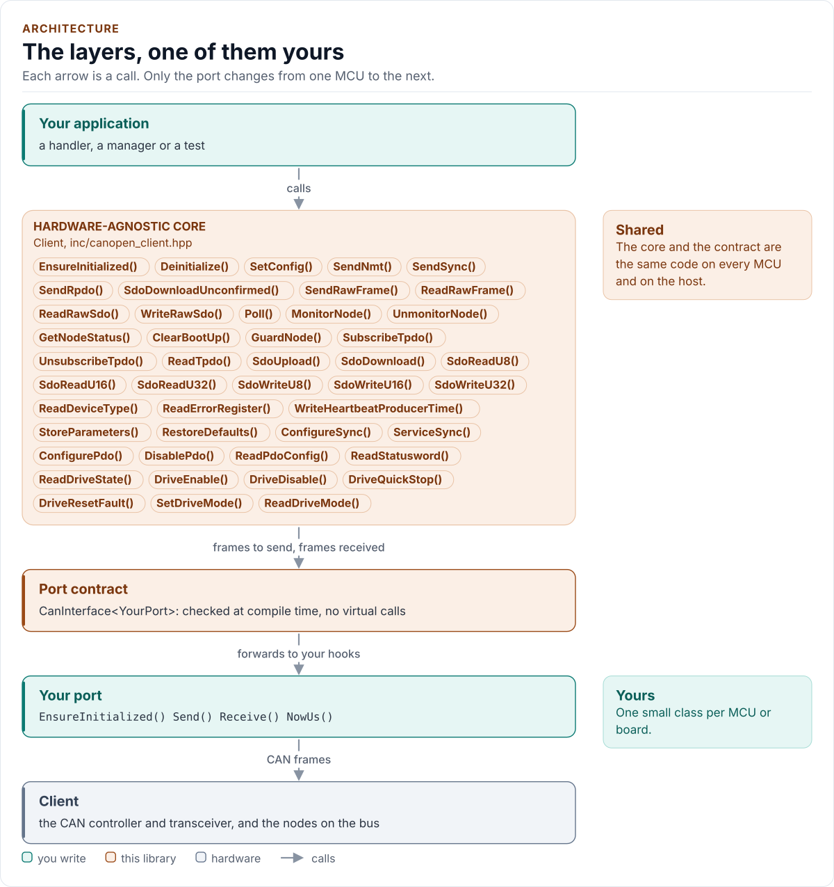

# Architecture

How the driver is built: the core, the port contract, and your port.

<!-- figure: driver-layers -->
<picture>
  <source media="(prefers-color-scheme: dark)" srcset="diagrams/driver-layers.dark.svg">
  
</picture>
<!-- /figure -->

| Layer | Files | Owns |
| --- | --- | --- |
| Core | [`inc/canopen_client.hpp`](../inc/canopen_client.hpp), [`src/canopen_client.ipp`](../src/canopen_client.ipp) | `Client<Port>`: lifecycle, the one request in flight, SDO transfers, the receive router, node table, EMCY queue, PDO configuration, the drive state machine |
| Protocol | [`inc/canopen_client_protocol.hpp`](../inc/canopen_client_protocol.hpp) | Pure `constexpr` frame builders and parsers: NMT, SDO, heartbeat, EMCY, SYNC, PDO, statusword decode; no state, no port |
| Types | [`inc/canopen_client_types.hpp`](../inc/canopen_client_types.hpp) | `Error`, `Result<T>`, `Config`, presets, identifiers, capacities |
| Port contract | [`inc/canopen_client_can_interface.hpp`](../inc/canopen_client_can_interface.hpp) | The CRTP base, the `CanPort` and `CanRxPort` concepts |
| Platform port | Your class | The CAN controller: `EnsureInitialized`, `Send`, `Receive`, `NowUs`, optionally `Log` |

## Two port levels

A port with `EnsureInitialized()` and `Send()` satisfies `CanPort`: the client can command (`SendNmt`, `SendSync`,
`SendRpdo`, `SdoDownloadUnconfirmed`). Adding `Receive()` and `NowUs()` satisfies `CanRxPort` and enables everything
that needs a reply: SDO, heartbeat, guarding, EMCY, TPDO, PDO configuration and the drive helpers. A call that needs a
reply on a send-only port does not compile; a port that has only one of `Receive` and `NowUs` is refused by a
`static_assert`.

## One request in flight

The client runs one SDO transfer at a time and every call blocks until it ends. While it waits for a reply, other
frames that arrive are not lost: heartbeats update the node table, EMCY frames are queued and TPDOs are stored, and a
flood of unrelated frames cannot hold a request past its timeout (`Stats::flood_aborts`). The driver starts no thread,
sleeps only through the port's `Receive()` and takes no lock.

## Fixed capacities

| Resource | Capacity | Full means |
| --- | --- | --- |
| Monitored nodes | 16 (`kMonitorCapacity`) | `MonitorNode()` returns `BufferTooSmall` |
| Subscribed TPDOs | 16 (`kPdoSubscriptionCapacity`) | `SubscribeTpdo()` returns `BufferTooSmall` |
| Queued EMCY events | 8 (`kEmcyQueueCapacity`) | The oldest are kept; new ones are dropped and counted in `Stats::emcy_dropped` |
| Entries in a PDO mapping | 16 (`kMaxPdoEntries`) | `ValidatePdoConfig()` refuses it |

Next: [Contract](contract.md).
