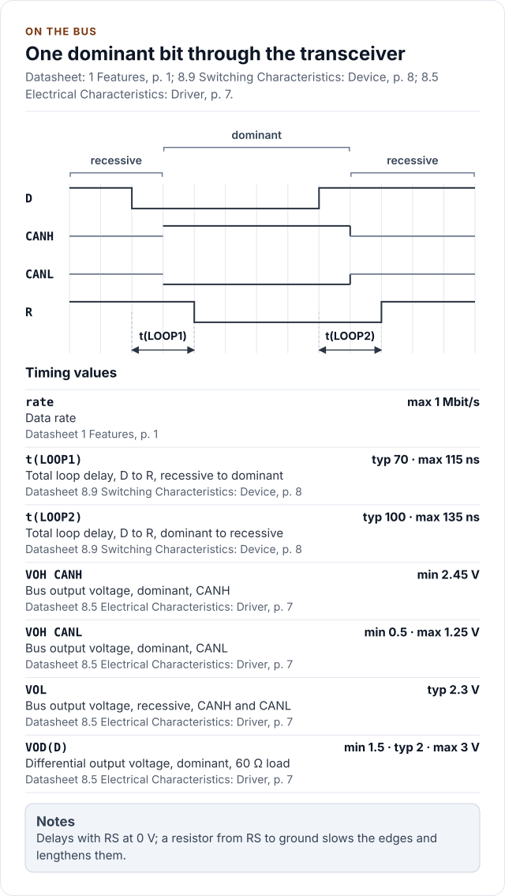
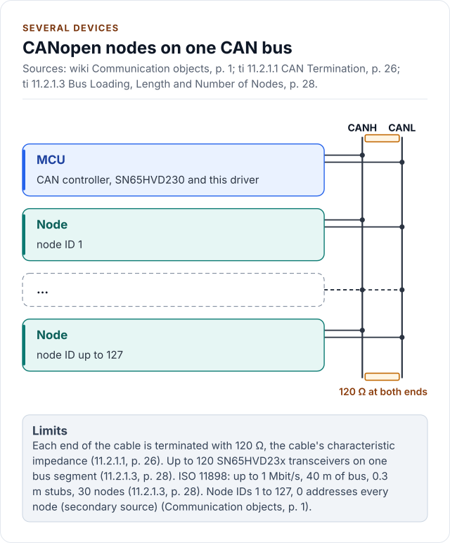

# On the bus

What a CANopen node built on the reference transceiver puts on the CAN bus, with every time, voltage and limit taken
from the documents in the [Datasheet map](datasheet.md). The physical layer comes from the Texas Instruments
SN65HVD230 datasheet (SLOS346O). CANopen's own specifications, CiA 301 and CiA 402, were not obtained, so the one
protocol number on this page, the node ID range, comes from a secondary source
([Ambiguities](ambiguities.md#secondary-sources-until-cia-301-and-cia-402-are-obtained)).

## CAN

The CAN controller drives the transceiver's D pin and reads its R pin. D low makes the bus dominant (CANH high, CANL
low); D high leaves it recessive, both lines resting near the middle. R follows the bus after the loop delay, which
bounds how long a bus can be at a given bit rate. The bit timing itself (bit rate, sample point) is set in the CAN
controller by your port; no held document gives CANopen's bit-timing table, so it is not drawn.

<!-- figure: can-timing -->
<picture>
  <source media="(prefers-color-scheme: dark)" srcset="diagrams/can-timing.dark.svg">
  
</picture>
<!-- /figure -->

## Several devices

Every CANopen node sits on the same twisted pair, CANH and CANL, with a 120 Ω resistor at each end of the cable. The
SN65HVD230 allows up to 120 transceivers on one bus segment; CANopen addresses each node by a 7-bit node ID.

<!-- figure: can-topology -->
<picture>
  <source media="(prefers-color-scheme: dark)" srcset="diagrams/can-topology.dark.svg">
  
</picture>
<!-- /figure -->

## How these figures are made

Each figure is a model in `docs/model/` (`can-timing.timing.yml` and `can-topology.topology.yml`) that cites the
document section and page of every number; `kokeb-docs figures` draws it and the build fails on a number without a
citation. The values table under the waveform is also written as `docs/diagrams/<id>.table.html`.
