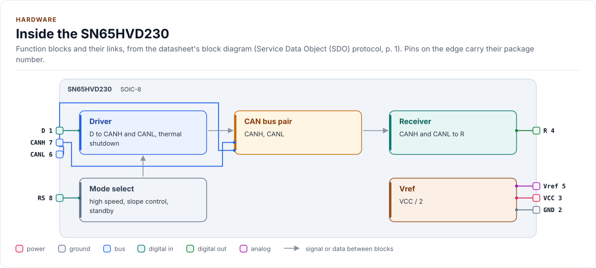
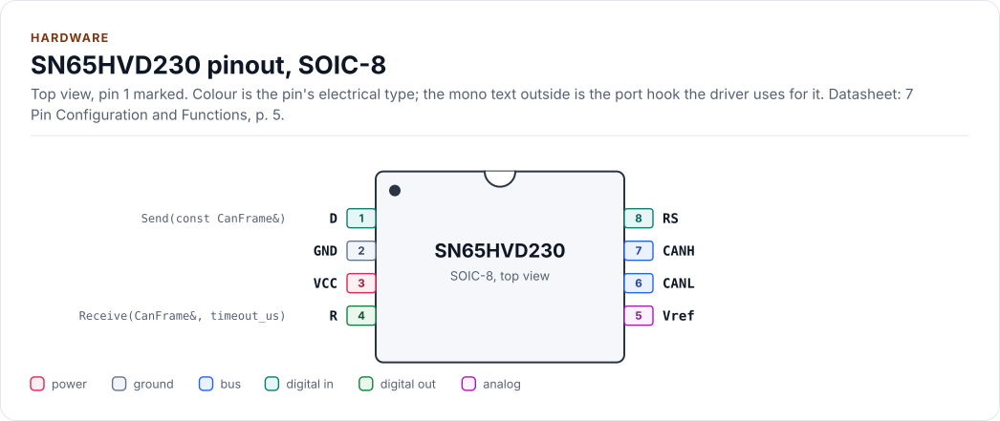
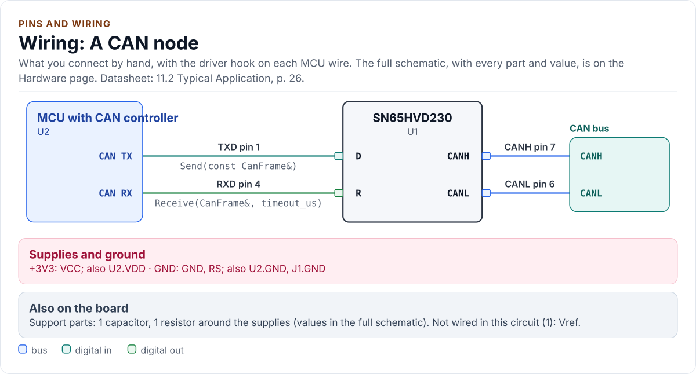

---
hide:
  - navigation
  - toc
---

<div class="kb-hero" markdown>
<span class="kb-kicker">CAN transceiver</span>

# CANOPEN_CLIENT Driver

<p>A generic C++20 CANopen client over a classic CAN frame port: NMT master, SDO client, heartbeat, emergency,
SYNC, PDOs and a CiA 402 drive state machine.</p>

[Quickstart](quickstart.md){ .md-button .md-button--primary }
[API guide](api-guide.md){ .md-button }
[Source on GitHub](https://github.com/kokeb-labs-drivers/driver-canopen-client){ .md-button }
</div>

<!-- generated: chip-summary -->
The **SN65HVD230** is a 3.3 V CAN transceiver, the reference physical layer of a CANopen node: it turns a CAN
controller's TXD and RXD into the differential CANH and CANL signals of an ISO 11898-2 bus, and this driver speaks
CANopen to the nodes on that bus (1 Features, 2 Applications, 3 Description, [p.
1](https://www.ti.com/lit/ds/symlink/sn65hvd230.pdf#page=1)).
<!-- /generated -->

<!-- figure: chip-hero -->
<picture>
  <source media="(prefers-color-scheme: dark)" srcset="diagrams/chip-hero.dark.svg">
  
</picture>
<!-- /figure -->

## What it does

<!-- figure: chip-capabilities -->
<picture>
  <source media="(prefers-color-scheme: dark)" srcset="diagrams/chip-capabilities.dark.svg">
  
</picture>
<!-- /figure -->

## Where it is used

<!-- generated: chip-uses -->
- Industrial automation, control, sensors and drive systems
- Motor and robotic control
- Building and climate control (HVAC)
- Telecom and basestation control and status
- CAN bus standards such as CANopen, DeviceNet and CAN Kingdom

Uses named by the datasheet (1 Features, 2 Applications, 3 Description, [p.
1](https://www.ti.com/lit/ds/symlink/sn65hvd230.pdf#page=1)).
<!-- /generated -->

## Inside the device

<!-- figure: chip-blocks -->
<picture>
  <source media="(prefers-color-scheme: dark)" srcset="diagrams/chip-blocks.dark.svg">
  
</picture>
<!-- /figure -->

## Pins and wiring

<!-- figure: chip-pinout -->
<picture>
  <source media="(prefers-color-scheme: dark)" srcset="diagrams/chip-pinout.dark.svg">
  
</picture>
<!-- /figure -->

<!-- figure: chip-wiring-typical -->
<picture>
  <source media="(prefers-color-scheme: dark)" srcset="diagrams/chip-wiring-typical.dark.svg">
  
</picture>
<!-- /figure -->

The reference circuit, the bus termination and the pins in full: [Hardware](hardware.md).

## Quick start

Wire the node as above, write the port ([Porting](porting.md)), then read a node's device type and start it:

```cpp
--8<-- "tests/docs/quickstart.cpp:quickstart"
```

The steps explained: [Quickstart](quickstart.md).

## Driver coverage

<!-- generated: chip-coverage -->
| Capability | What the protocol does | Driver API | Objects | Status | Host test | Datasheet |
| --- | --- | --- | --- | --- | --- | --- |
| [Start and stop nodes](api-guide.md) | Sends the NMT commands that start, stop, pre-operate and reset one node or all of them | `SendNmt` | `PreOperational`, `ResetNode`, `ResetCommunication` | Supported | [`test_lifecycle.cpp`](../tests/test_lifecycle.cpp) | Network management (NMT), p. 1 |
| [Read and write objects](api-guide.md) | Reads and writes object dictionary entries, in one frame or in segments, with the node's abort code | `SdoUpload`, `SdoDownload`, `SdoReadU8`, `SdoReadU16`, `SdoReadU32`, `SdoWriteU8`, `SdoWriteU16`, `SdoWriteU32`, `SdoDownloadUnconfirmed` | - | Supported | [`test_sdo.cpp`](../tests/test_sdo.cpp) | SdoClient: initiate, upload, download, segments, p. 1 |
| [Heartbeat, guarding and emergencies](api-guide.md) | Watches node heartbeats and guarding replies, and queues the emergency messages nodes send | `MonitorNode`, `UnmonitorNode`, `GetNodeStatus`, `ClearBootUp`, `GuardNode`, `Poll`, `PopEmcy` | - | Supported | [`test_rx.cpp`](../tests/test_rx.cpp), [`test_faults.cpp`](../tests/test_faults.cpp) | CO_HBconsumer.c, p. 1 |
| [SYNC producer](api-guide.md) | Sends the SYNC frame, once or on a period with the optional counter byte | `SendSync`, `ConfigureSync`, `ServiceSync` | - | Supported | [`test_rx.cpp`](../tests/test_rx.cpp) | CO_SYNC.h: SYNC frame and counter, p. 1 |
| [Process data](api-guide.md) | Maps and enables a node's PDOs in the order the profile asks, reads TPDO samples and sends RPDOs | `ConfigurePdo`, `DisablePdo`, `ReadPdoConfig`, `SubscribeTpdo`, `UnsubscribeTpdo`, `ReadTpdo`, `SendRpdo` | - | Supported | [`test_pdo.cpp`](../tests/test_pdo.cpp) | PDO map and communication records, p. 1 |
| [CiA 402 drive control](api-guide.md) | Reads the drive state and walks it to enabled, disabled, quick stop or fault reset, and sets the mode (disable and quick stop are never refused for the drive state) | `ReadDriveState`, `ReadStatusword`, `DriveEnable`, `DriveDisable`, `DriveQuickStop`, `DriveResetFault`, `SetDriveMode`, `ReadDriveMode` | `ProfilePosition`, `Velocity`, `ProfileVelocity`, `CyclicSynchronousPosition` | Supported | [`test_drive.cpp`](../tests/test_drive.cpp) | BaseNode402: states, masks, transitions, p. 1 |
| [Node identity and settings](api-guide.md) | Reads a node's device type and error register, sets its heartbeat time, stores or restores its parameters | `ReadDeviceType`, `ReadErrorRegister`, `WriteHeartbeatProducerTime`, `StoreParameters`, `RestoreDefaults` | - | Supported | [`test_sdo.cpp`](../tests/test_sdo.cpp) | CO_storage.c: signatures and sub-indices, p. 1 |
| [Raw frames](api-guide.md) | Sends and reads any classic CAN frame and returns the raw reply of an SDO request | `SendRawFrame`, `ReadRawFrame`, `ReadRawSdo`, `WriteRawSdo` | - | Supported | [`test_hardening.cpp`](../tests/test_hardening.cpp) | Pre-defined connection set (COB-IDs), p. 1 |
| [Block transfer, FD and LSS](contract.md) | Block transfer, CAN FD, 29-bit identifiers, LSS, an NMT slave and an SDO server are not implemented | - | - | Not covered | - | Service Data Object (SDO) protocol, p. 1 |

**Supported**: the driver implements it and the named host test checks it; **Not covered**: the protocol defines it and
the driver leaves it out.

From [`docs/hardware.yml`](hardware.yml); `kokeb-docs hardware --check` confirms that every API name is in
`inc/canopen_client.hpp`, `inc/canopen_client_types.hpp` and every object in `inc/canopen_client_types.hpp`,
`inc/canopen_client_protocol.hpp` and every named test exists.
<!-- /generated -->

The driver is not tied to a product or to a CAN controller. You give it a small class that sends one 11-bit frame,
waits for one and reads a microsecond clock; it does the rest: the SDO transfer rules, heartbeat ageing, the
emergency queue, PDO configuration in the order the profile prescribes and the drive's state transitions.

- **One object per bus**, no I/O until `EnsureInitialized()`. See [API guide](api-guide.md).
- **Errors you can act on**: `Result<T>` with an `Error`, and the node's own SDO abort code. See
  [Contract](contract.md).
- **Zero-overhead portability**: a CRTP port checked by a concept; a send-only port gets a send-only API. See
  [Porting](porting.md).
- **Tested without hardware** against an independent model of the bus and its nodes. See [Testing and CI](testing.md).

## Datasheet

<!-- generated: datasheet-card -->
| Document | Revision | Get it |
| --- | --- | --- |
| Datasheet: SN65HVD23x 3.3-V CAN Bus Transceivers (Texas Instruments SN65HVD230, SN65HVD231, SN65HVD232 (SLOS346)) | O, 2018-04 | [PDF](https://www.ti.com/lit/ds/symlink/sn65hvd230.pdf) · [vendor page](https://www.ti.com/product/SN65HVD230) |
| Reference: CANopen (Wikipedia contributors Wikipedia article (oldid 1373604442)) | last edited September 2026, 2026-09 | [vendor page](https://en.wikipedia.org/wiki/CANopen) |
| Reference: CANopen Explained - A Simple Intro (CSS Electronics canopen-tutorial-simple-intro) | 2026 edition, 2026 | [vendor page](https://www.csselectronics.com/pages/canopen-tutorial-simple-intro) |
| Source: CANopenNode 301/CO_SDOserver.h (CANopenNode project CO_SDOserver.h) | master as downloaded, 2026-11 | [vendor page](https://github.com/CANopenNode/CANopenNode/blob/master/301/CO_SDOserver.h) |
| Source: CANopenNode 301/CO_Emergency.h (CANopenNode project CO_Emergency.h) | master as downloaded, 2026-11 | [vendor page](https://github.com/CANopenNode/CANopenNode/blob/master/301/CO_Emergency.h) |
| Source: CANopenNode 301/CO_HBconsumer.c (CANopenNode project CO_HBconsumer.c) | master as downloaded, 2026-11 | [vendor page](https://github.com/CANopenNode/CANopenNode/blob/master/301/CO_HBconsumer.c) |
| Source: CANopenNode 301/CO_SYNC.h (CANopenNode project CO_SYNC.h) | master as downloaded, 2026-11 | [vendor page](https://github.com/CANopenNode/CANopenNode/blob/master/301/CO_SYNC.h) |
| Source: CANopenNode storage/CO_storage.c (CANopenNode project CO_storage.c) | master as downloaded, 2026-11 | [vendor page](https://github.com/CANopenNode/CANopenNode/blob/master/storage/CO_storage.c) |
| Source: canopen/sdo/client.py (christiansandberg python-canopen sdo/client.py) | master as downloaded, 2026-11 | [vendor page](https://github.com/christiansandberg/canopen/blob/master/canopen/sdo/client.py) |
| Source: canopen/sdo/constants.py (christiansandberg python-canopen sdo/constants.py) | master as downloaded, 2026-11 | [vendor page](https://github.com/christiansandberg/canopen/blob/master/canopen/sdo/constants.py) |
| Source: canopen/sdo/base.py (christiansandberg python-canopen sdo/base.py) | master as downloaded, 2026-11 | [vendor page](https://github.com/christiansandberg/canopen/blob/master/canopen/sdo/base.py) |
| Source: canopen/nmt.py (christiansandberg python-canopen nmt.py) | master as downloaded, 2026-11 | [vendor page](https://github.com/christiansandberg/canopen/blob/master/canopen/nmt.py) |
| Source: canopen/emcy.py (christiansandberg python-canopen emcy.py) | master as downloaded, 2026-11 | [vendor page](https://github.com/christiansandberg/canopen/blob/master/canopen/emcy.py) |
| Source: canopen/network.py (christiansandberg python-canopen network.py) | master as downloaded, 2026-11 | [vendor page](https://github.com/christiansandberg/canopen/blob/master/canopen/network.py) |
| Source: canopen/pdo/base.py (christiansandberg python-canopen pdo/base.py) | master as downloaded, 2026-11 | [vendor page](https://github.com/christiansandberg/canopen/blob/master/canopen/pdo/base.py) |
| Source: canopen/profiles/p402.py (christiansandberg python-canopen profiles/p402.py) | master as downloaded, 2026-11 | [vendor page](https://github.com/christiansandberg/canopen/blob/master/canopen/profiles/p402.py) |

Written against these revisions; the SHA-256 of each file is in [`docs/datasheets.yml`](datasheets.yml). Where each part
of the driver is in the datasheet: [Datasheet map](datasheet.md).
<!-- /generated -->
